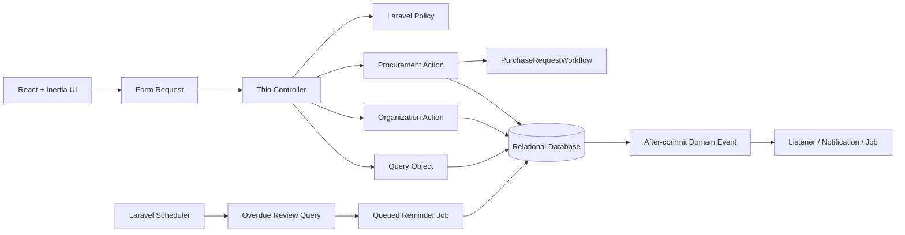
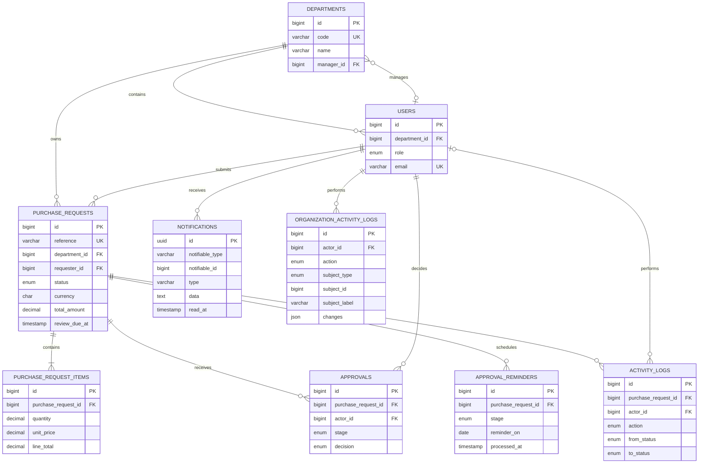

# FlowGate

FlowGate gives organizations a clear, traceable path from purchase request
intake through manager and procurement approval to completion. Its bilingual
React interface is backed by a Laravel-native modular monolith that keeps
workflow rules on the server and records every state change atomically.

## Engineering highlights

- Laravel 13, PHP 8.3+, Inertia 3, React 19, TypeScript, and Tailwind CSS 4.
- Explicit application Actions for procurement use cases.
- One `PurchaseRequestWorkflow` state machine for all transition rules.
- Policies as the only authorization boundary.
- Atomic status, approval, and activity-log writes.
- Role-scoped approval queues for designated managers and procurement reviewers.
- Manager approval, procurement approval, and reason-required rejection flows.
- Requester cancellation and procurement-owned completion flows.
- After-commit, role-aware database notifications with a user-scoped inbox.
- Stage-specific approval deadlines persisted with workflow transitions.
- Hourly scheduled discovery and idempotent queued overdue reminders.
- Administrator-only department, manager, role, and membership management.
- Atomic organization audit entries for every administrative assignment change.
- Role-aware operational dashboards with server-owned workflow metrics.
- Policy-scoped procurement reports with bounded filters and streaming CSV
  export.
- Events dispatched only after the surrounding database transaction commits.
- Eloquent models limited to relationships, casts, and query scopes.
- Arabic RTL and English LTR from one component system.
- Pest feature, unit, and architecture tests plus Larastan, Pint, ESLint,
  Prettier, TypeScript, and production-build checks.

## Architecture



The dependency direction stays inward: HTTP coordinates use cases, Domain owns
workflow behavior, Models map persistence, and infrastructure side effects react
to committed events. See [docs/architecture.md](docs/architecture.md) for the
boundary rules and transition flow.

## Data model



Money is stored as `DECIMAL`; foreign keys, unique constraints, and workflow
indexes are defined in migrations. A unique request, stage, and reminder-date
constraint makes scheduled reminders safe to retry. Organization activity
entries retain a human-readable subject snapshot and the exact changed fields
without storing credentials or other secrets.

## Local setup

Requirements: PHP 8.3+, Composer 2, Node.js 22+, and npm.

```bash
composer setup
composer dev
```

The default local database is SQLite. Copy `.env.example` to `.env` if the setup
script has not already done so. `composer dev` runs the HTTP server, queue,
scheduler, logs, and Vite so approval reminders work locally.

### Demo accounts

Run `php artisan db:seed` to create an idempotent demo organization and purchase
requests, including an overdue manager review that demonstrates the SLA queue.
Every demo account uses the password `password`.

| Role | Email |
| --- | --- |
| Requester | `test@example.com` |
| Manager | `manager@flowgate.test` |
| Procurement | `procurement@flowgate.test` |
| Administrator | `admin@flowgate.test` |

## Quality gates

```bash
composer validate --strict
composer test
npm run lint:check
npm run format:check
npm run types:check
npm run build
```

The same checks run in GitHub Actions for pull requests and pushes to `main`.
A second job migrates and runs the Pest suite against MySQL 8.4 to catch
database-specific behavior before release.

## Documentation

- [Architecture and state transitions](docs/architecture.md)
- [Design system](docs/design-system.md)
- [Queue, scheduler, health, and deployment operations](docs/operations.md)

## License

FlowGate is released under the [MIT License](LICENSE).
