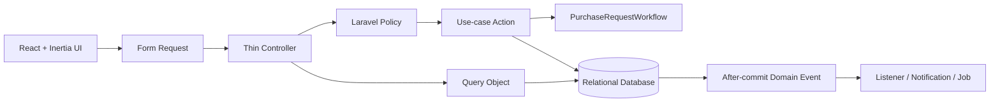
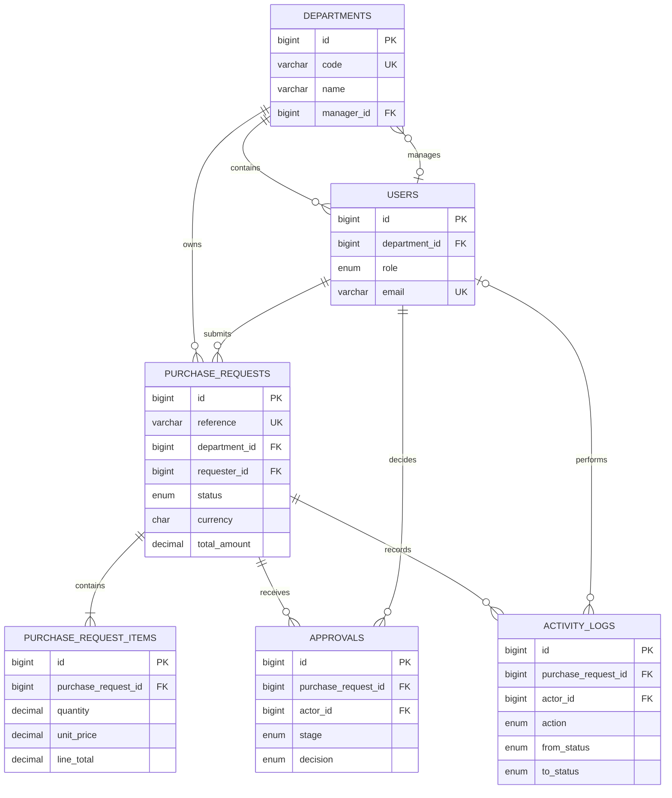

# FlowGate

FlowGate is a bilingual procurement approval application built to demonstrate a
practical Laravel-native modular monolith. It keeps workflow rules on the
server, records every state change atomically, and exposes a focused React
interface through Inertia.

## Engineering highlights

- Laravel 13, PHP 8.3+, Inertia 3, React 19, TypeScript, and Tailwind CSS 4.
- Explicit application Actions for procurement use cases.
- One `PurchaseRequestWorkflow` state machine for all transition rules.
- Policies as the only authorization boundary.
- Atomic status, approval, and activity-log writes.
- Events dispatched only after the surrounding database transaction commits.
- Eloquent models limited to relationships, casts, and query scopes.
- Arabic RTL and English LTR from one component system.
- Pest feature, unit, and architecture tests plus Larastan, Pint, ESLint,
  Prettier, TypeScript, and production-build checks.

## Architecture



The dependency direction stays inward: HTTP coordinates use cases, Domain owns
workflow behavior, Models map persistence, and infrastructure side effects react
to committed events. See [docs/architecture.md](docs/architecture.md) for the
boundary rules and transition flow.

## Data model



Money is stored as `DECIMAL`; foreign keys, unique constraints, and workflow
indexes are defined in migrations.

## Local setup

Requirements: PHP 8.3+, Composer 2, Node.js 22+, and npm.

```bash
composer setup
composer dev
```

The default local database is SQLite. Copy `.env.example` to `.env` if the setup
script has not already done so.

## Quality gates

```bash
composer validate --strict
composer test
npm run lint:check
npm run format:check
npm run types:check
npm run build
```

The same checks run in GitHub Actions for pull requests and pushes to `main`.

## Documentation

- [Architecture and state transitions](docs/architecture.md)
- [Design system](docs/design-system.md)

## License

FlowGate is released under the [MIT License](LICENSE).
