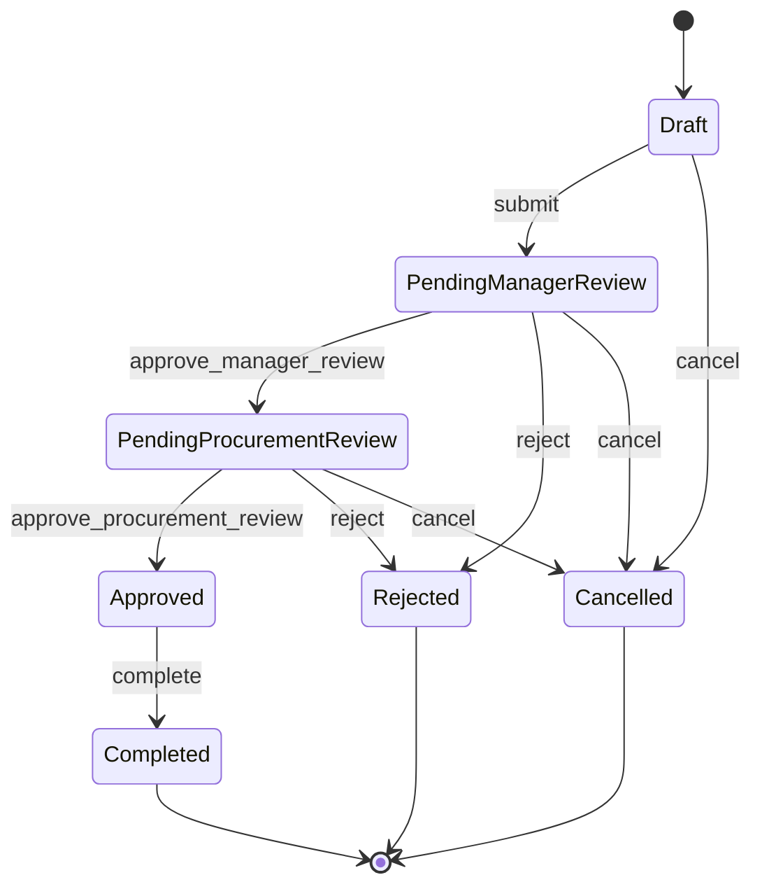
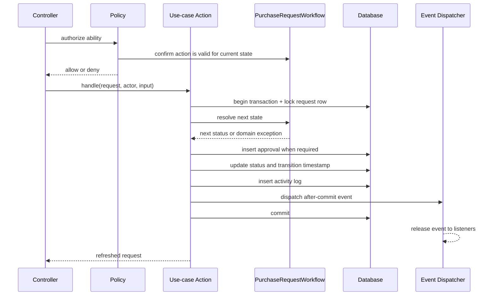

# Architecture

## Intent

FlowGate is a Laravel-native modular monolith. The code is split by business
capability inside one deployable application and one relational database. The
goal is explicit boundaries and reliable workflow behavior without framework
wrappers or speculative abstractions.

The initial modules are:

- `Organization`: users, roles, departments, and reporting ownership.
- `Procurement`: purchase requests, items, approvals, workflow rules, and audit
  history.

## Application boundaries

```text
app/
├── Domain/
│   ├── Organization/
│   └── Procurement/
│       ├── Actions/
│       ├── Enums/
│       ├── Events/
│       ├── Exceptions/
│       ├── Queries/
│       └── Rules/
├── Http/
│   ├── Controllers/
│   └── Requests/
├── Models/
├── Policies/
├── Notifications/
├── Jobs/
└── Listeners/
```

- Controllers authorize, invoke one Action or Query, and return a response.
- Form Requests validate and normalize external input.
- Actions implement use cases and own their transaction boundary.
- `PurchaseRequestWorkflow` is the only source of valid state transitions.
- Query Objects hold filtering or read-model composition that would make a
  controller difficult to scan.
- Models contain relationships, casts, and scopes only.
- Policies contain all role, ownership, and department authorization rules.
- Events describe completed domain facts; listeners handle side effects.
- Eloquent is used directly. Generic repositories, base services, and base
  controllers are intentionally absent.

The architecture test suite prevents Domain-to-HTTP dependencies, direct
database/model access from controllers, authorization inside Actions, generic
repository/service layers, and application files without strict types.

## State machine



| Current status | Action | Next status | Approval record |
| --- | --- | --- | --- |
| `draft` | `submit` | `pending_manager_review` | No |
| `draft` | `cancel` | `cancelled` | No |
| `pending_manager_review` | `approve_manager_review` | `pending_procurement_review` | Manager / approved |
| `pending_manager_review` | `reject` | `rejected` | Manager / rejected |
| `pending_manager_review` | `cancel` | `cancelled` | No |
| `pending_procurement_review` | `approve_procurement_review` | `approved` | Procurement / approved |
| `pending_procurement_review` | `reject` | `rejected` | Procurement / rejected |
| `pending_procurement_review` | `cancel` | `cancelled` | No |
| `approved` | `complete` | `completed` | No |

Rejected, completed, and cancelled requests are terminal. A future rule change
must first be made in `PurchaseRequestWorkflow` and covered by its transition
matrix tests.

## State-transition transaction



`TransitionPurchaseRequest` is a focused internal Action shared by the public
use-case Actions. It exists because transaction, row locking, audit logging, and
event dispatch are repeated invariants—not as a generic service layer.

## Authorization and `allowedActions`

The UI receives only actions that satisfy both conditions:

1. the workflow permits the action in the persisted state; and
2. the relevant policy permits the authenticated user to perform it.

`AllowedPurchaseRequestActionsQuery` composes those two answers. It is a UI hint,
not a security boundary. Every mutation endpoint must authorize the same policy
ability again immediately before invoking its Action.

The approval queue is also policy-driven. Designated department managers receive
only `pending_manager_review` requests for departments they manage, while
procurement and administrator users receive `pending_procurement_review`
requests. `PendingApprovalReviewsQuery` owns that scoped, searchable read model;
the queue never grants permission to decide a request.

## Data integrity

- Foreign keys define ownership and deletion behavior.
- A request can have at most one approval per review stage.
- Request references and department codes are unique.
- Money uses fixed-precision `DECIMAL` columns.
- Request-list access paths are indexed by status, department, requester, and
  creation time.
- Transitions lock the current request row to prevent concurrent reviewers from
  applying two decisions to the same state.
- Approval, activity log, timestamps, and status are committed atomically.

## Request intake boundary

`SavePurchaseRequestRequest` normalizes the create/edit payload and validates
one to twenty-five item rows. `CreatePurchaseRequest` and
`UpdateDraftPurchaseRequest` then own their database transactions:

- the requester and department are derived from the authenticated user;
- the public reference is generated by the server after the database assigns
  the request id;
- quantity, unit price, line totals, and request total are calculated with
  scaled integers rather than floating-point arithmetic;
- request and item writes commit together;
- updates lock the request row and replace items only while its persisted
  status is `draft`.

The React form may display an estimate, but it never submits or persists a
trusted total.

The locale preference crosses the HTTP boundary through a non-sensitive
`locale` cookie. `HandleLocale` selects only `ar` or `en` before validation and
response rendering, so translated validation errors and flash feedback match the
same locale used by the React direction hook.

`PurchaseRequestsIndexQuery` owns search, status filtering, pagination, eager
loading, and role-aware visibility. Requesters see their own requests, managers
see departments they are designated to manage, and procurement or administrator
roles see the full workspace. Individual detail and mutation endpoints still
authorize through `PurchaseRequestPolicy`; query scoping is not a replacement
for policy checks.

## Approval decision boundary

Approval comments are optional and rejection reasons are mandatory. Dedicated
Form Requests trim both inputs and cap them at 2,000 characters before the thin
HTTP controllers authorize and invoke `ApproveManagerReview`,
`ApproveProcurementReview`, or `RejectPurchaseRequest`.

The controllers do not choose the next status or approval stage. They pass the
authenticated actor and normalized input to the use-case Action;
`PurchaseRequestWorkflow` derives the transition and
`TransitionPurchaseRequest` locks the row before atomically writing the
approval, status, timestamp, and activity log. A stale or unauthorized UI action
therefore cannot bypass the persisted workflow or policy.

## Event boundary

`PurchaseRequestTransitioned` implements Laravel's
`ShouldDispatchAfterCommit`. Notifications, queued work, or integrations must
listen to that event rather than running inside the transaction. Failed
transactions therefore produce neither committed audit data nor external side
effects.

`SendPurchaseRequestTransitionNotifications` is discovered as a Laravel event
listener. It reloads the committed request, resolves recipients through
`PurchaseRequestNotificationRecipientsQuery`, and writes a semantic database
notification. Stored data contains English contract keys and workflow values;
the React client owns Arabic/English presentation.

| Committed transition | Notification recipients |
| --- | --- |
| Submit | Designated manager of the request department |
| Manager approval | Procurement and administrator users |
| Procurement approval | Requester |
| Rejection | Requester |
| Completion | Requester |
| Cancellation during manager review | Designated department manager |
| Cancellation during procurement review | Procurement and administrator users |
| Draft cancellation | None |

The actor is always excluded from the recipient list. Notification reads are
scoped through the authenticated user's notification relationship, so another
user's UUID returns `404` instead of exposing or mutating that record.

## Lifecycle and notification HTTP boundary

Approved requests can be completed only by procurement or administrator users.
Draft or in-review requests can be cancelled only by their requester. The
completion and cancellation controllers re-authorize the corresponding Policy
ability and invoke `CompletePurchaseRequest` or `CancelPurchaseRequest`; they do
not select the next state themselves. Cancellation comments are optional,
trimmed, limited to 2,000 characters, and stored with the atomic activity log
when present.

The notification inbox is a read model composed by
`UserNotificationsIndexQuery`. `MarkNotificationAsRead` and
`MarkAllNotificationsAsRead` are explicit Organization Actions. The shared
unread count is a navigation hint only and never grants access to a
notification.

## Organization administration boundary

Organization administration is available only when the authenticated user's
Policies allow it. The shared `auth.can.manageOrganization` value controls
navigation visibility, but every route and mutation authorizes again on the
server.

The module exposes three focused read models:

- `DepartmentsIndexQuery` owns department search, pagination, aggregate counts,
  the current manager, and server-qualified manager candidates.
- `OrganizationUsersIndexQuery` owns user search, role and department filters,
  organization assignments, and managed-department context.
- `OrganizationActivityIndexQuery` owns the append-only administrative audit
  feed and its filters.

Mutations use explicit Actions and database transactions:

- `CreateDepartment` normalizes and creates an unassigned department.
- `UpdateDepartment` changes its identity or assigns a manager.
- `UpdateUserOrganizationAssignment` changes a user's role or department.

The following invariants are rechecked while the affected rows are locked:

- a department manager must have the manager role and belong to that department;
- a manager's role or department cannot change while they still manage a
  department;
- the final administrator cannot be demoted;
- manager-role users must belong to a department;
- department codes remain unique and are stored in uppercase.

Each successful mutation writes an `OrganizationActivityLog` in the same
transaction. The entry records the actor, action, stable subject label, and only
the fields that changed. Failed validation or failed persistence therefore
produces neither a partial organization update nor an audit entry. Destructive
department or user operations are deliberately absent from this phase so
procurement and audit history cannot be orphaned. The starter-kit self-service
account deletion entry point is hidden and policy-denied for the same reason.

## Operational reporting boundary

The dashboard and procurement report are server-owned read models. They do not
reimplement workflow or authorization in React:

- `VisiblePurchaseRequestsQuery` is the shared source of role-aware data scope.
  Requesters receive their own requests, designated managers receive requests
  from departments they manage, and procurement or administrator users receive
  the organization-wide scope.
- `DashboardQuery` composes counts, committed value, status distribution,
  action-required rows, and recent requests from that scope. Drafts require
  requester action, manager-review rows require designated-manager action, and
  procurement-review or approved rows require procurement/administrator
  action.
- `PurchaseRequestPolicy::viewReports` is the only authorization source for the
  report routes and the shared report-navigation hint. Requesters cannot access
  operational reports.
- `ProcurementReportQuery` applies the same scope to a validated maximum
  366-day period, optional status, and optional department. It calculates
  summary metrics, status and department breakdowns, a monthly trend, and the
  paginated detail read model on the server.
- `ExportProcurementReport` streams the same filtered Query Object to UTF-8 CSV
  in bounded chunks. Export therefore cannot broaden the browser-visible scope
  and does not load the entire result set into memory.

The display-only `scope` key and shared `auth.can.viewProcurementReports`
boolean help React choose wording and navigation. Neither grants access; report
routes authorize again and all report totals are recalculated from persisted
`DECIMAL` values. Reporting access paths are indexed by creation time and by
department plus creation time.

## Deliberate omissions

- No microservices or message broker: there is no deployment or scaling evidence
  that requires them.
- No repository wrapper around Eloquent: it would duplicate the ORM without
  adding a boundary.
- No generic base Action, service, controller, or response class.
- No frontend-owned workflow or final monetary calculations.

New abstractions are accepted only when they remove demonstrated repetition or
contain a real integration boundary.
