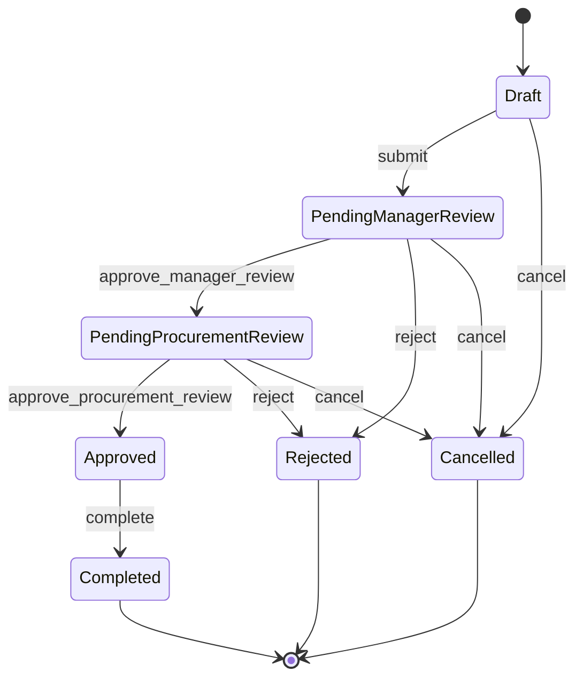
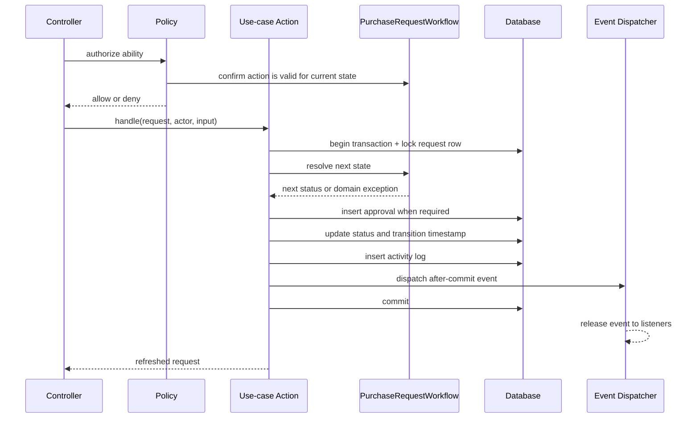

# Architecture

## Intent

FlowGate is a Laravel-native modular monolith. The code is split by business
capability inside one deployable application and one relational database. The
goal is explicit boundaries and reliable workflow behavior without framework
wrappers or speculative abstractions.

The initial modules are:

- `Organization`: users, roles, departments, and reporting ownership.
- `Procurement`: purchase requests, items, approvals, workflow rules, and audit
  history.

## Application boundaries

```text
app/
├── Domain/
│   ├── Organization/
│   └── Procurement/
│       ├── Actions/
│       ├── Enums/
│       ├── Events/
│       ├── Exceptions/
│       ├── Queries/
│       └── Rules/
├── Http/
│   ├── Controllers/
│   └── Requests/
├── Models/
├── Policies/
├── Notifications/
├── Jobs/
└── Listeners/
```

- Controllers authorize, invoke one Action or Query, and return a response.
- Form Requests validate and normalize external input.
- Actions implement use cases and own their transaction boundary.
- `PurchaseRequestWorkflow` is the only source of valid state transitions.
- Query Objects hold filtering or read-model composition that would make a
  controller difficult to scan.
- Models contain relationships, casts, and scopes only.
- Policies contain all role, ownership, and department authorization rules.
- Events describe completed domain facts; listeners handle side effects.
- Eloquent is used directly. Generic repositories, base services, and base
  controllers are intentionally absent.

The architecture test suite prevents Domain-to-HTTP dependencies, direct
database/model access from controllers, authorization inside Actions, generic
repository/service layers, and application files without strict types.

## State machine



| Current status | Action | Next status | Approval record |
| --- | --- | --- | --- |
| `draft` | `submit` | `pending_manager_review` | No |
| `draft` | `cancel` | `cancelled` | No |
| `pending_manager_review` | `approve_manager_review` | `pending_procurement_review` | Manager / approved |
| `pending_manager_review` | `reject` | `rejected` | Manager / rejected |
| `pending_manager_review` | `cancel` | `cancelled` | No |
| `pending_procurement_review` | `approve_procurement_review` | `approved` | Procurement / approved |
| `pending_procurement_review` | `reject` | `rejected` | Procurement / rejected |
| `pending_procurement_review` | `cancel` | `cancelled` | No |
| `approved` | `complete` | `completed` | No |

Rejected, completed, and cancelled requests are terminal. A future rule change
must first be made in `PurchaseRequestWorkflow` and covered by its transition
matrix tests.

## State-transition transaction



`TransitionPurchaseRequest` is a focused internal Action shared by the public
use-case Actions. It exists because transaction, row locking, audit logging, and
event dispatch are repeated invariants—not as a generic service layer.

## Authorization and `allowedActions`

The UI receives only actions that satisfy both conditions:

1. the workflow permits the action in the persisted state; and
2. the relevant policy permits the authenticated user to perform it.

`AllowedPurchaseRequestActionsQuery` composes those two answers. It is a UI hint,
not a security boundary. Every mutation endpoint must authorize the same policy
ability again immediately before invoking its Action.

## Data integrity

- Foreign keys define ownership and deletion behavior.
- A request can have at most one approval per review stage.
- Request references and department codes are unique.
- Money uses fixed-precision `DECIMAL` columns.
- Request-list access paths are indexed by status, department, requester, and
  creation time.
- Transitions lock the current request row to prevent concurrent reviewers from
  applying two decisions to the same state.
- Approval, activity log, timestamps, and status are committed atomically.

## Request intake boundary

`SavePurchaseRequestRequest` normalizes the create/edit payload and validates
one to twenty-five item rows. `CreatePurchaseRequest` and
`UpdateDraftPurchaseRequest` then own their database transactions:

- the requester and department are derived from the authenticated user;
- the public reference is generated by the server after the database assigns
  the request id;
- quantity, unit price, line totals, and request total are calculated with
  scaled integers rather than floating-point arithmetic;
- request and item writes commit together;
- updates lock the request row and replace items only while its persisted
  status is `draft`.

The React form may display an estimate, but it never submits or persists a
trusted total.

`PurchaseRequestsIndexQuery` owns search, status filtering, pagination, eager
loading, and role-aware visibility. Requesters see their own requests, managers
see their department, and procurement or administrator roles see the full
workspace. Individual detail and mutation endpoints still authorize through
`PurchaseRequestPolicy`; query scoping is not a replacement for policy checks.

## Event boundary

`PurchaseRequestTransitioned` implements Laravel's
`ShouldDispatchAfterCommit`. Notifications, queued work, or integrations must
listen to that event rather than running inside the transaction. Failed
transactions therefore produce neither committed audit data nor external side
effects.

## Deliberate omissions

- No microservices or message broker: there is no deployment or scaling evidence
  that requires them.
- No repository wrapper around Eloquent: it would duplicate the ORM without
  adding a boundary.
- No generic base Action, service, controller, or response class.
- No frontend-owned workflow or final monetary calculations.

New abstractions are accepted only when they remove demonstrated repetition or
contain a real integration boundary.
